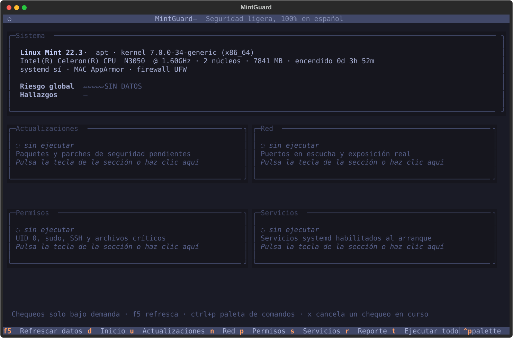
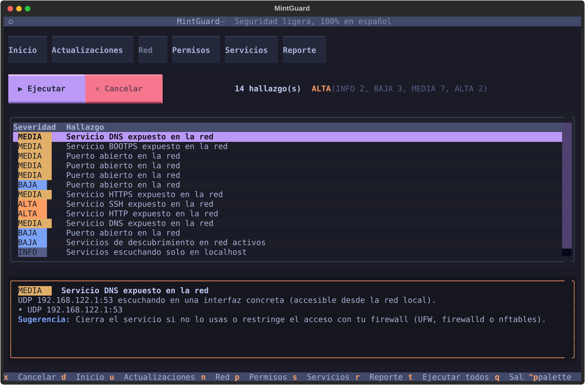
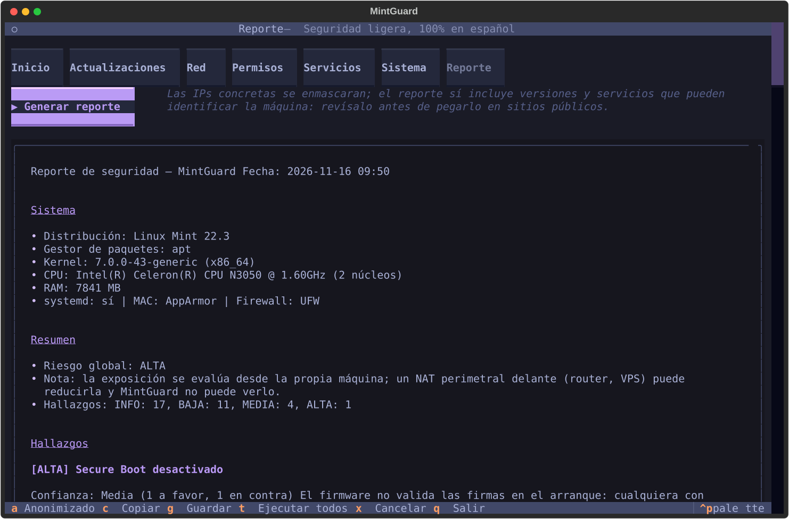

# MintGuard



TUI de seguridad **ligera** para Linux, hecha con [Textual](https://textual.textualize.io),
**100% en español**. Detecta problemas, los prioriza según la **exposición real** de tu
máquina, sugiere correcciones concretas y genera reportes limpios para copiar.

No compite con Lynis ni con rkhunter, y no es un antivirus: es una herramienta de
**revisión rápida y legible para equipos de escritorio**, pensada para hardware modesto
(Celeron, 8 GB RAM, HDD) donde los scanners clásicos tardan demasiado.

## Alcance honesto (v0.2.0)

- **Verificado de verdad solo en la familia apt**: Debian, Ubuntu y Linux Mint.
- Los parsers de `dnf`, `pacman` y `zypper` existen y tienen tests unitarios, pero **no
  se han probado en hardware real** de esas distribuciones (objetivo v1.1).
- Revisa 4 áreas: actualizaciones, red, permisos y servicios. No escanea malware ni rootkits.
- **Snapshot, no monitorización**: cada chequeo es una foto del momento. Nada corre en
  segundo plano ni al abrir la app; los datos de red son intrínsecamente dinámicos.

## Qué revisa

| Área | Qué hace | Mejora con `sudo` |
| --- | --- | --- |
| Actualizaciones | paquetes actualizables + cuántos son de seguridad (simulación de `apt dist-upgrade`) | refresca el índice |
| Red | puertos en escucha (`ss`) clasificados por exposición: todas las interfaces / una interfaz / solo localhost | muestra el proceso dueño |
| Permisos | UID 0 extraños, contraseñas vacías, permisos de `passwd`/`shadow`/`sudoers`, configuración de sshd | lee `/etc/shadow` |
| Servicios | servicios systemd habilitados al arranque; marca telnet, tftp, rsh… | (sin cambios) |

## Estrategia de privilegios

- **Nunca pide contraseña y nunca bloquea la TUI** esperando nada: no hay `sudo` interno.
- Sin privilegios funciona con datos limitados, y cada hallazgo incompleto lo dice y
  sugiere cómo completarlo.
- Si quieres la revisión completa: `sudo .venv/bin/mintguard` (la app es de solo lectura).

## Chequeo lento, sin sensación de cuelgue

La simulación de `dist-upgrade` tarda **~30 s en hardware lento** (HDD): es el coste real
de saber qué updates son de seguridad. La pantalla muestra spinner y aviso del tiempo, y
puedes **cancelar con `x`**: la interfaz responde al instante; el comando en curso termina
en su timeout y su resultado se descarta.

## Privacidad del reporte

El reporte **no incluye hostname ni IPs**, pero sí kernel, versiones y servicios que
pueden identificar una máquina concreta. La pantalla de reporte te lo avisa antes de
copiarlo o guardarlo.



## Instalación y uso

```bash
python3 -m venv .venv
.venv/bin/pip install -e .      # única dependencia: textual
.venv/bin/mintguard
```

| Tecla | Acción |
| --- | --- |
| `d` `u` `n` `p` `s` `r` | Inicio · Actualizaciones · Red · Permisos · Servicios · Reporte |
| `t` | ejecutar todos los chequeos |
| `Enter` | ejecutar el chequeo de la pantalla actual |
| `x` | cancelar el chequeo en curso |
| `f5` | refrescar datos del sistema |
| `ctrl+p` | paleta de comandos |
| `q` | salir |

## Tests

En una herramienta de seguridad, un parser roto produce **falsos negativos**: el usuario
cree estar protegido y no lo está. Por eso todo parser (`apt`, `dnf`, `pacman`, `zypper`,
`ss`, `systemctl`, `passwd`, `shadow`, `sshd_config`) tiene tests unitarios con `unittest`
de la biblioteca estándar, sin dependencias extra:

```bash
.venv/bin/python -m unittest discover -s tests
```

Además hay un smoke test de la interfaz completo (headless, ~35 s, ejecuta los chequeos
de verdad): `.venv/bin/python tools/smoke_ui.py`



## Limitaciones conocidas

- **Snapshot**: lo que ves es el estado del momento, no vigilancia continua.
- La clasificación de exposición es local y heurística: `0.0.0.0` se marca como expuesto
  porque no se puede saber si hay NAT o un firewall delante desde la propia máquina.
- `dnf`/`pacman`/`zypper`: implementados pero sin verificación en distros reales.
- El nombre "MintGuard" se quedó corto para algo multi-distro; se estudia renombrar.

## Estructura

```text
MintGuard/
├── AGENTS.md               # contrato para agentes de código
├── README.md
├── pyproject.toml
├── docs/img/               # capturas del README
├── tools/                  # smoke de UI, medición de arranque, capturas
├── tests/                  # unittest (solo biblioteca estándar)
└── src/mintguard/
    ├── main.py             # punto de entrada
    ├── core/               # distro, sistema, exposición, priorización
    ├── checks/             # updates, network, permissions, services
    ├── reporting/          # generador de reportes
    └── ui/                 # app Textual, pantallas y widgets
```
